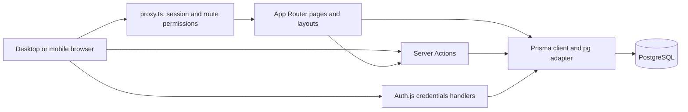
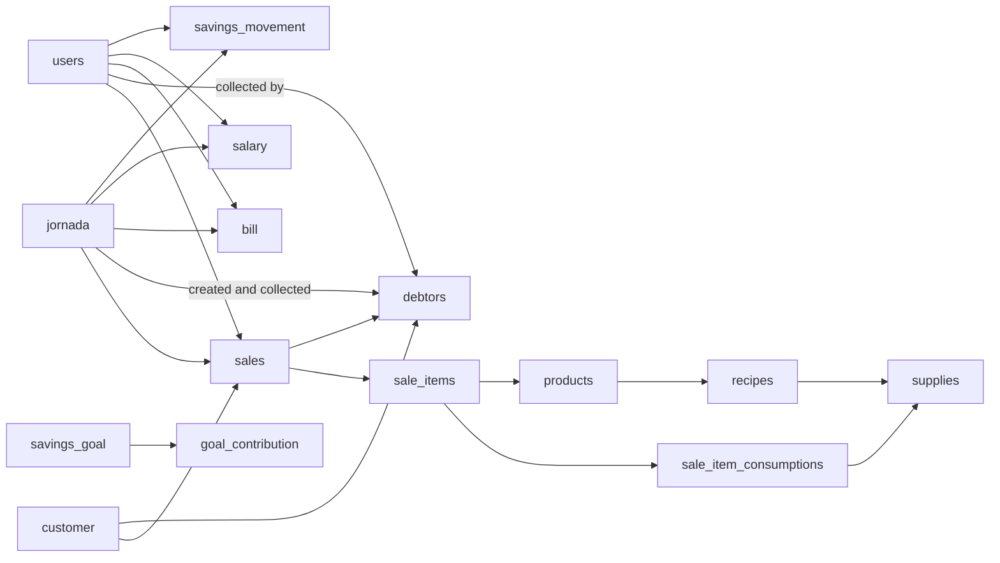

# Architecture

Comal Core runs pages, authentication and business operations in one Next.js
application. Browsers call Server Actions, which read and write PostgreSQL
through Prisma. Desktop and mobile views share this backend.

CRM, Inventory, Menu and Debtors table owners explicitly opt out of React
Compiler memoization while using TanStack Table v8's mutable instance API.
Other components retain the normal compiler/lint behavior.

## Request flow

[`proxy.ts`](proxy.ts) uses [`app/auth.config.ts`](app/auth.config.ts) to check
sessions and route access. Guests can reach `/login`. Authenticated users denied
a route are redirected to `/pos`. See [Request interception](docs/middleware.md).

Server Components load page data. Client Components handle dialogs, filters,
optimistic updates and action calls. Paginated lists load through client calls
to Server Actions. Each action checks its own session or role; route permissions
do not replace these checks. Auth.js exposes GET and POST
handlers through [`app/api/auth/route.ts`](app/api/auth/route.ts).

## Code map

| Location | Responsibility |
| --- | --- |
| `app/(auth)/login/` | One-time owner setup, owner login, fixed/mobile staff login, and browser-link request flow |
| `app/(dashboard)/layout.tsx` | Navigation, jornada banner and refresh |
| `app/(dashboard)/page.tsx` | Welcome page |
| `app/(dashboard)/pos/` | Desktop/mobile sales views and optimistic updates |
| `app/(dashboard)/debtors/`, `expenses/` | Debt collection and expense screens |
| `app/(dashboard)/admin/` | Administration, jornada, statistics and reports |
| `components/layout/` | Shared navigation, banner and refresh components |
| `components/pagination/` | Pagination controls and server-page loading for desktop and mobile |
| `lib/pagination/` | Server-safe list contract, validation, limits, offsets and metadata |
| `components/ui/` | Shared Radix/shadcn UI components |
| `components/Sales-input-client.tsx` | Desktop receipt, settlement and debt dialogs |
| `components/Transfer-confirmation-dialog.tsx` | Manual transfer confirmation |
| `lib/actions/` | Business queries, mutations and Zod schemas |
| `lib/action-result.ts` | Standardized `ActionResult<T>` contract (`actionOk`, `actionFail`) |
| `lib/cash-change.ts` | Integer-cent cash input parsing and change/shortfall calculation |
| `lib/monetary.ts` | Exact `BigInt` half-to-even rounding, recipe costing and proportional cent allocation |
| `lib/scaled-values.ts` | Safe-integer boundary conversion, parsing and formatting for cents and milliunits |
| `lib/jornada-cash.ts` | Shared cash cut calculation |
| `lib/analytics.ts` | Date ranges, report types, formatting and CSV helpers |
| `lib/pos-source.ts` | Account identifiers and display labels |
| `lib/ticket-reservations.ts` | PostgreSQL-backed guest ticket reservations and advisory locks |
| `lib/auth.ts`, `lib/auth-credentials.ts`, `lib/auth-lockout.ts`, `app/auth.config.ts` | Credentials provider, role verification, login lockout, JWT and session callbacks |
| `lib/permissions.ts`, `lib/server-permissions.ts`, `lib/auth-types.ts` | Route access, capability catalog, current server authorization and role types |
| `lib/prisma.ts` | Runtime client, connection pool and development singleton |
| `lib/database-env.ts` | Runtime and migration URL selection, including isolated Preview connections |
| `lib/device-settings.ts`, `lib/store.ts` | Persisted browser UI state |
| `next.config.ts` | Next.js configuration and HTTP security headers |
| `prisma/schema.prisma`, `prisma/migrations/` | Database models and schema history |
| `prisma/seed.ts`, `prisma/sequence_fix.ts` | Demo data and manual sequence repair |
| `tests/integration/`, `tests/e2e/` | Database integration and browser tests |

[Modules](docs/modules.md) maps screens to routes and action files.

## Data relationships

Sale items preserve their unit price, subtotal and recorded ingredient
consumption. Recipe edits do not change the stock restored for items with a
consumption snapshot. Recipes and supply costs remain current catalog data.
Accounts use `sales.source_type`.
Unpopulated guest ticket reservations are persisted in `setting` under
`TICKET_RES:<jornadaId>:<ticketNumber>` keys until consumed by the first sale,
released by token, expired after 15 minutes, or cleared on jornada closure.
Guest sales also carry the `ticketAccountId` UUID that identifies the account
independently of the ticket number.

Debt rows record their creation and collection jornadas. The cash cut attributes
a collection to the jornada that received the money. Customer debt balance is
stored in `customer.currentBalanceCents` and updated by the actions.
See [Database](docs/database.md) for fields and constraints.

## Transactions and consistency

| Operation | Transaction boundary |
| --- | --- |
| `createSale` | Sale, items, stock, guest ticket reservation and customer/debt updates share one transaction under the active shift lock |
| `nextFreeSaleTicket`, `releaseTicketReservationAction` | Serialized per jornada with `pg_advisory_xact_lock`; reservations persist in PostgreSQL (`setting`) |
| Checkout, quantity change or cancellation | Eligibility checks and writes share a transaction. Quantity changes and cancellations also lock the sale row |
| `toDebt`, `payAccount` | Sale and customer ownership checks, status changes and balance updates share a transaction under the active shift lock |
| `addContribution` | Contribution and possible goal completion share a transaction |
| Analytics | Each result uses a `RepeatableRead` transaction. The timeout is 30 seconds |
| Shift opening and closing, expenses, payroll and savings | Opening is serialized. Closing and movements coordinate under the active shift lock. Withdrawal checks run in the movement transaction |

[`lib/jornada-cash.ts`](lib/jornada-cash.ts) supplies both the live cash summary
and the amounts calculated inside the closing transaction. A later export
reads a new database snapshot. See [Business rules](docs/business-rules.md) for
the limits.

## Browser state and refresh

Desktop and mobile POS views use the same actions. `usePosSaleQueue` queues
product taps sequentially, keeps pending optimistic rows with negative IDs
visible until their confirmed server records arrive, prunes retired optimistic
entries once committed or superseded by a newer server snapshot, and applies a
1-second cooldown to a product button after 3 consecutive taps. React
`useOptimistic` shows pending removals and quantity changes. Editing stays
disabled until pending additions complete and the server returns a real ID.

`AutoRefresh` calls `router.refresh()` and notifies subscribed client lists every
10 seconds while the tab is visible and when it becomes visible again. It skips
both operations while promises wrapped by `trackAction` are pending.
`usePolling` runs client callbacks at the same default interval and on tab
return, without using that action counter.

Paginated lists share `usePaginationState` and `usePaginatedResource`. The first
stores route-local criteria in browser history and `sessionStorage`; the second
loads pages through POST Server Actions, ignores obsolete responses and handles
page clamping. Mutation handlers refresh their client-owned lists explicitly.
See [Pagination](docs/pagination.md) for the contract and consumer inventory.

`hasOpenJornada` and `getActiveJornadaWithStats` use `React.cache` to reuse work
within a server render. They do not cache business state across requests.

| State | Storage |
| --- | --- |
| Submenu, counter and user name UI state | `app-storage` in browser `localStorage` |
| Terminal name | `device-settings` in `localStorage`. Rehydrated after mount |
| List page, size, search, filters and tab | Route-local `history.state` and `sessionStorage` |
| Business CLABE | PostgreSQL `setting` table, shared by terminals |
| CSV export | Built in the browser from authenticated export data |

Desktop navigation starts at `lg`. Smaller screens use the bottom navigation;
Jornada appears in the user menu. Page pagination stays above the bottom
navigation when a list has multiple pages. Embedded pickers keep their controls
inside the picker.

`usePaginationFocus` retains the owning list or picker across responsive view
replacement. The dashboard content defines the page scope separately from the
sidebar; command pickers and popovers provide local scopes. Deferred focus
restoration lets nested Radix dialogs release their focus traps first.
[Testing](docs/testing.md#pagination-focus-regressions) records the remaining
pending-request and desktop size-selector failures.

Printing uses the browser dialog, which may save a PDF. Refresh uses polling;
there is no WebSocket service.

## Runtime and deployment

The runtime opens up to four PostgreSQL connections per application instance.
Development reuses the client through a global singleton. Runtime and Prisma CLI
use the Preview connection variables when `VERCEL_ENV=preview`. See
[Deployment](docs/deploy.md) for environment configuration.

`npm ci` generates the ignored Prisma client through `postinstall`.
`npm run build` applies migrations before building Next.js. The deployment
guidance covers Vercel and hosting on your own server. The repository has no application Docker setup or deployment CI workflow.
GitHub Actions runs five independent checks for PRs and pushes to `dev`/`main`:
lint, PostgreSQL integration tests, a migration-backed production build, an
npm dependency audit, and full Playwright browser tests. Integration, build and
E2E each have a separate disposable PostgreSQL service and no deployment
credentials. E2E starts its own development server and uploads failure evidence. See
[CI checks](docs/testing.md#continuous-integration).
A separate workflow mirrors public `main` to a configured private repository;
it does not depend on CI success and does not deploy.

The browser must reach the app server. The server must reach PostgreSQL.
The browser cannot queue sales while the server is unavailable.

The project has no packaged offline installer or integrated backup workflow.
Hosting locally does not add recovery when a connection fails.

## Scope

Statistics and reports are beta features. They describe paid sales, expenses,
salary payments, identified customers and current pending debts. Fiado has
collection timestamps. Ordinary sales have no general settlement timestamp.

Forecasts, historical recipe profit, a complete cash flow ledger, bank
reconciliation and receipt printer integration are outside the implementation.
For setup and checks, see [Getting started](docs/getting-started.md),
[Deployment](docs/deploy.md) and [Testing](docs/testing.md).
