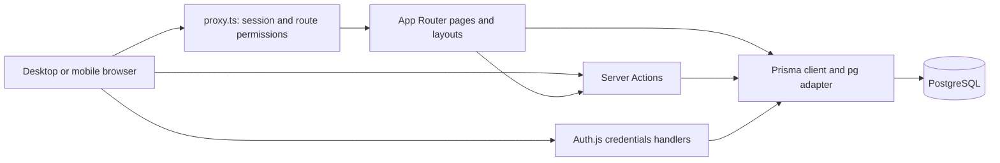
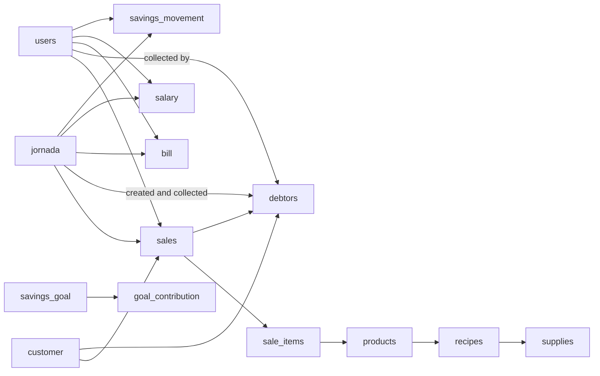

# Architecture

Comal Core runs pages, authentication and business operations in one Next.js
application. Browsers call Server Actions, which read and write PostgreSQL
through Prisma. Desktop and mobile views share this backend.

## Request flow

[`proxy.ts`](proxy.ts) uses [`app/auth.config.ts`](app/auth.config.ts) to check
sessions and route access. Guests can reach `/login`. Authenticated users denied
a route are redirected to `/pos`. See [Request interception](docs/middleware.md).

Server Components load page data. Client Components handle dialogs, filters,
optimistic updates and action calls. Each action checks its own session or role. Route permissions do not replace these checks. Auth.js exposes GET and POST
handlers through [`app/api/auth/route.ts`](app/api/auth/route.ts).

## Code map

| Location | Responsibility |
| --- | --- |
| `app/(auth)/login/` | ADMIN and STAFF login forms |
| `app/(dashboard)/layout.tsx` | Navigation, jornada banner and refresh |
| `app/(dashboard)/page.tsx` | Welcome page |
| `app/(dashboard)/pos/` | Desktop/mobile sales views and optimistic updates |
| `app/(dashboard)/debtors/`, `expenses/` | Debt collection and expense screens |
| `app/(dashboard)/admin/` | Administration, jornada, statistics and reports |
| `components/layout/` | Shared navigation, banner and refresh components |
| `components/pagination/` | Pagination controls and server-page loading for desktop and mobile |
| `components/ui/` | Shared Radix/shadcn UI components |
| `components/Sales-input-client.tsx` | Desktop receipt, settlement and debt dialogs |
| `components/Transfer-confirmation-dialog.tsx` | Manual transfer confirmation |
| `lib/actions/` | Business queries, mutations and Zod schemas |
| `lib/jornada-cash.ts` | Shared cash cut calculation |
| `lib/analytics.ts` | Date ranges, report types, formatting and CSV helpers |
| `lib/pos-source.ts` | Account identifiers and display labels |
| `lib/auth.ts`, `app/auth.config.ts` | Credentials provider, JWT and session callbacks |
| `lib/permissions.ts`, `lib/auth-types.ts` | Route access, central `isAdmin` helper and role normalization |
| `lib/prisma.ts` | Runtime client, connection pool and development singleton |
| `lib/device-settings.ts`, `lib/store.ts` | Persisted browser UI state |
| `next.config.ts` | Next.js configuration and HTTP security headers |
| `prisma/schema.prisma`, `prisma/migrations/` | Database models and schema history |
| `prisma/seed.ts`, `prisma/sequence_fix.ts` | Demo data and manual sequence repair |
| `tests/integration/`, `tests/e2e/` | Database integration and browser tests |

[Modules](docs/modules.md) maps screens to routes and action files.

## Data relationships

Sale items preserve their unit price and subtotal. Recipes and supply costs
remain current catalog data. Accounts are grouped by `sales.source_type`. There is no separate account record or ticket reservation table.

Debt rows record their creation and collection jornadas. The cash cut attributes
a collection to the jornada that received the money. Customer debt balance is
stored in `customer.currentBalance` and updated by the actions.
See [Database](docs/database.md) for fields and constraints.

## Transactions and consistency

| Operation | Transaction boundary |
| --- | --- |
| `createSale` | Sale, items, stock and customer/debt updates share one transaction |
| Checkout, quantity change or cancellation | Eligibility checks and writes share a transaction. Quantity changes and cancellations also lock the sale row |
| `toDebt`, `payAccount` | Sale and customer ownership checks, status changes and balance updates share a transaction under the active shift lock |
| `addContribution` | Contribution and possible goal completion share a transaction |
| Analytics | Each result uses a `RepeatableRead` transaction. The timeout is 30 seconds |
| Shift opening and closing, expenses, payroll and savings | Opening is serialized. Closing and movements coordinate under the active shift lock. Withdrawal checks run in the movement transaction |

[`lib/jornada-cash.ts`](lib/jornada-cash.ts) supplies both the live cash summary
and the amounts calculated inside the closing transaction. A later export
reads a new database snapshot. See [Business rules](docs/business-rules.md) for
the limits.

## Browser state and refresh

Desktop and mobile POS views use the same actions. React `useOptimistic` shows
pending additions, removals and quantity changes. Temporary sales have negative
IDs. Editing stays disabled until the server returns a real ID.

`AutoRefresh` calls `router.refresh()` every 10 seconds while the tab is visible
and when it becomes visible again. It skips ticks while promises wrapped by
`trackAction` are pending. `usePolling` refreshes client data on visible
ticks at the same default interval, without using that action counter.

`hasOpenJornada` and `getActiveJornadaWithStats` use `React.cache` to reuse work
within a server render. They do not cache business state across requests.

| State | Storage |
| --- | --- |
| Submenu, counter and user name UI state | `app-storage` in browser `localStorage` |
| Terminal name | `device-settings` in `localStorage`. Rehydrated after mount |
| Business CLABE | PostgreSQL `setting` table, shared by terminals |
| CSV export | Built in the browser from authenticated export data |

Printing uses the browser dialog, which may save a PDF. Refresh uses polling. There is no WebSocket service.

## Runtime and deployment

The runtime opens up to four PostgreSQL connections per application instance.
Development reuses the client through a global singleton. Runtime and Prisma CLI
use the Preview connection variables when `VERCEL_ENV=preview`. See
[Deployment](docs/deploy.md) for environment configuration.

`npm ci` generates the ignored Prisma client through `postinstall`.
`npm run build` applies migrations before building Next.js. The deployment
guidance covers Vercel and hosting on your own server. The repository has no
Docker setup or deployment CI workflow.

The browser must reach the app server. The server must reach PostgreSQL.
The browser cannot queue sales while the server is unavailable.

The project has no packaged offline installer or integrated backup workflow.
Hosting locally does not add recovery when a connection fails.

## Scope

Statistics and reports are beta features. They describe paid sales, expenses,
salary payments, identified customers and current pending debts. Fiado has
collection timestamps. Ordinary sales have no general settlement timestamp.

Forecasts, historical recipe profit, a complete cash flow ledger, bank
reconciliation and receipt printer integration are outside the implementation.
For setup and checks, see [Getting started](docs/getting-started.md),
[Deployment](docs/deploy.md) and [Testing](docs/testing.md).
