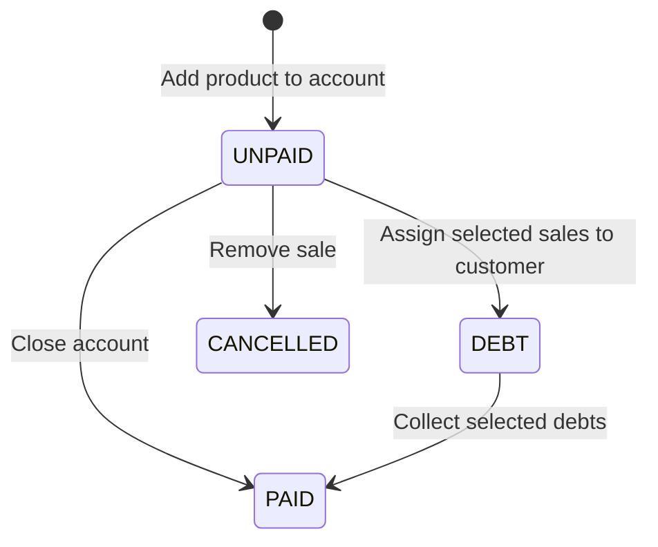

# Business rules

This reference describes the implemented behavior of Comal Core. It separates
server checks from interface controls and records the limits that matter when
changing or operating the system. Function contracts are in
[Action reference](actions.md). Screens are in [Modules](modules.md).

Action amounts are safe integer cents. Supply stock and recipe quantities are
integer milliunits; sale item quantities are whole counts. Forms display pesos
and supply units. [Database](database.md#money-and-historical-data) explains the
storage and conversion boundaries.

## Terms

| Term              | Meaning                                                                           |
| ----------------- | --------------------------------------------------------------------------------- |
| Jornada           | Shared cash shift used by multiple users. OPEN or CLOSED                          |
| Account           | Sale records grouped by source_type                                               |
| Sale record       | Persisted order entry. A POS product tap normally creates one                     |
| Guest ticket      | Reusable `VL-<n>` identifier for an open guest account                            |
| Debt / fiado      | Sale assigned to a customer for later full collection                             |
| Cash cut          | Expected cash and transfers for a jornada. Only cash has a counted closing amount |
| Pool              | Savings deposits minus withdrawals                                                |
| Goal contribution | Progress assigned to a savings goal, independent of pool movements                |

## 1. Authentication and authorization

Sources: [authentication](../lib/auth.ts),
[login actions](../lib/actions/auth_action.ts) and
[route permissions](../lib/permissions.ts).

The unique owner (`ADMIN`) signs in from any browser with email and password.
`SUPERVISOR` and `STAFF` sign in with personal six-digit PINs from an
owner-authorized fixed or mobile browser. Mobile terminals also require a
username. Inactive accounts and unknown roles cannot log in.

First-owner setup requires the server-only `INSTALLATION_SECRET` and a persisted
first-installation state. It creates one active owner and does not open a
session. Setup does not reopen after initialization or when user rows are
deleted. Owner recovery is a server-side maintenance operation on the existing
owner account.

JWT sessions expire eight hours after authentication and include the user,
role, authentication mode, terminal and credential version. Current activity,
permissions and terminal authorization are checked for protected requests.
Changing role, permissions, PIN, terminal type or active status affects existing
sessions on their next request.

All roles may use the common POS, expenses and debts flows as allowed by their
capabilities. The owner configures delegable permissions for Supervisor and
Service; the owner-only capabilities are fixed. The full defaults and capability
matrix are in [Authentication](auth.md). Actions check authorization
independently of route access and navigation. Business rules such as paid-sale
immutability, closed-shift restrictions, balance checks and stock constraints
still apply after permission is granted.

Actions identify the employee through the session. This applies to sales,
expenses, savings, jornada control and debt collection.

Every staff browser requests owner approval as a fixed or mobile terminal.
Requests expire after ten minutes. The server stores a hash of the browser
token and uses a secure HttpOnly cookie for authorization. Changing a terminal's
type or revoking it ends its staff sessions. Regenerating a PIN or deactivating
an account also invalidates its sessions. PIN lockout lasts 15 minutes after
five failed attempts.

## 2. Sales and account lifecycle

Sources: [sales actions](../lib/actions/sales.ts),
[account identifiers](../lib/pos-source.ts),
[desktop POS](<../app/(dashboard)/pos/pos-manager.tsx>) and
[mobile POS](<../app/(dashboard)/pos/MobilePosManager.tsx>).

### Creation and inventory

`createSale` requires a session and an OPEN jornada. It validates item IDs and
positive integer quantities, the source/customer fields, payment method and a
status other than CANCELLED. An omitted payment method defaults to CASH.

The server reads prices in integer cents and recipes in integer milliunits,
computes `subtotalCents = priceCents × quantity`, stores item unit prices and
subtotals and subtracts `quantityUsedMilliunits × item quantity` from each supply.
Sale, stock and related customer/debt changes share a transaction.

New sales and quantity increases require an active product and active recipe
supplies. Quantity increases also check the recorded consumption supplies.
Disabled products and products with disabled ingredients are excluded from the
POS catalog. Existing accounts can still be settled, reduced or cancelled within
the usual role and jornada rules.

A linked customer's lastConsumption is updated. Customer ID -1 or a falsy ID
means no customer. Creating a DEBT sale with a customer also creates its debtor
row and increases the customer's balance. The normal POS starts with UNPAID
records and settles them later.

Stock availability is not checked before creating a sale or increasing quantity,
so stock can become negative. Shape validation does not establish ownership or
make every business state transition safe.

### Source identifiers

| Source             | Account                    |
| ------------------ | -------------------------- |
| `MESA_<n>`         | Table                      |
| `CL- <customerId>` | Customer selected from CRM |
| `VL-<n>`           | Open guest ticket          |
| `VENTA_LIBRE`      | Settled guest history      |

The server selects the lowest positive ticket number not used by UNPAID sales
or active PostgreSQL-persisted reservations in the active jornada. Selection
runs inside a transaction guarded by a PostgreSQL advisory lock
(`pg_advisory_xact_lock`) and returns a unique `reservationToken`, so concurrent
requests across terminals and server instances receive distinct ticket numbers.
Reservations expire after 15 minutes if no sale is placed, are atomically
consumed by the first `createSale` on that ticket (after which the `UNPAID`
sale row itself keeps the number taken until paid, converted to debt, or
cancelled), can be explicitly released with their matching `reservationToken`
when switching away from an empty ticket, and are cleared atomically when the
jornada closes. The first sale assigns the ticket a persistent UUID. Subsequent
sales on that account share the UUID, even if its original lines are removed.

Customer accounts use the customer primary key (`CL- <customerId>`), ensuring
customers with duplicate names maintain independent accounts. source_type is
limited to 30 characters. See [Database](database.md).

### Normal state transitions



Checkout submits the selected sale IDs and the confirmed total for CASH or
TRANSFER. All selected sales must still be unpaid, match the account and belong
to the active shift. Changed sales or totals return `SALES_CHANGED`. Sales from
another shift return `DIFFERENT_JORNADA`. Later additions remain unpaid. A paid
guest sale moves to `VENTA_LIBRE`, freeing the ticket number once the account is empty.

The account view shows UNPAID records. Payment or debt conversion returns the
operator to venta libre. Switching views alone does not settle an account.
The POS loads today's sales using the business timezone (America/Mexico_City).
Cancelled sales are excluded. Open UNPAID accounts belonging to the active jornada
remain available across midnight.

`updateSaleQuantity` keeps the stored unit price, adjusts stock using the
recorded per-unit ingredient consumption snapshot (or current recipes when
`consumptionRecorded` is false), and recalculates totals. It requires a positive integer quantity. The
POS decrement from one explicitly cancels the whole sale. Cancellation restores
stock using the recorded ingredient consumption snapshot (or current recipes when
`consumptionRecorded` is false), marks the sale CANCELLED, and retains its
records. Repeated cancellation fails.

For historical records with multiple lines of the same product, quantity
reductions remove the newest units first and preserve each remaining line's
price and consumption snapshot. Reductions restore stock without consuming
different ingredients. Quantity increases extend the oldest line.

PAID sales cannot be cancelled or modified by anyone, including ADMIN. The backend
checks the locked sale inside the transaction and returns `CANNOT_CANCEL_PAID_SALE`
or `CANNOT_MODIFY_PAID_SALE` before making any changes. This also applies to
collected debts and historical PAID sales without a jornada or payment method.
Only the owner can cancel or modify DEBT sales. Supervisor and Service may
cancel or modify UNPAID sales when granted the pending-sales capability. Sales
belonging to a closed jornada cannot be cancelled
or modified. Cancelling a sale with an open debt also cancels that debt and reduces
the customer balance. Modifying the quantity of an open debt sale synchronizes the
debtor amount and customer balance. CANCELLED sales and paid debts cannot be modified.

Legacy debt sales without `sales.jornadaId` inherit their originating shift from
`debtors.createdJornadaId`. Edits and cancellations serialize with that shift's
closure and reject a concurrent change in shift ownership with `SALES_CHANGED`.
Balance checks and adjustments lock the customer row so concurrent legacy debt
changes cannot move balances outside safe integer cents.

Recipe edits only affect future sales; sales with recorded consumption snapshots
always reverse or adjust stock using the ingredients and quantities recorded
when the sale was created.

## 3. Payment confirmation

Sources: [desktop dialog](../components/Sales-input-client.tsx),
[mobile POS](<../app/(dashboard)/pos/MobilePosManager.tsx>),
[debt dialog](<../app/(dashboard)/debtors/debt-payment-dialog.tsx>) and
[transfer dialog](../components/Transfer-confirmation-dialog.tsx).

| Flow                     | Cash                                                                                               | Transfer                     |
| ------------------------ | -------------------------------------------------------------------------------------------------- | ---------------------------- |
| Desktop POS              | Receipt, optional informational received-cash/change calculation, and explicit confirmation button | Shared transfer confirmation |
| Mobile POS               | Required received amount and calculated change                                                     | Shared transfer confirmation |
| Deudores, desktop/mobile | Required received amount and calculated change                                                     | Shared transfer confirmation |

Cash inputs accept nonnegative amounts with up to two decimal places, using
dot or comma and no thousands separators, within safe integer cents. In desktop
POS, the received-cash input and change/shortfall display are informational and
never block confirmation; in mobile POS and Deudores, empty, invalid or
insufficient amounts block payment. Mobile POS and Deudores reject received cash above
`90071992547409.91` (the safe integer-cent limit).

Change equals received cents minus the sum of each sale total rounded to cents.
Insufficient cash shows the missing amount. Enter in the mobile cash input
blurs it. Only the confirmation button records payment. Received cash and
change are UI state, not stored payment fields.

The transfer dialog loads CLABE, shows the total and asks the operator to
confirm receipt. Confirmation is blocked while loading. A blank CLABE shows
a notice but does not block confirmation once loading finishes.
Cancelling either payment dialog leaves the account unpaid.

Transfers are confirmed manually. There is no bank lookup, automatic
reconciliation or verification token. Settlement actions accept a method and
update status. They do not require proof that the UI confirmation occurred.

## 4. Debts and customer balance

Source: [debts.ts](../lib/actions/debts.ts).

`toDebt` and `payAccount` require a session and an OPEN jornada. Otherwise they
return UNAUTHORIZED or NO_OPEN_JORNADA. They validate the customer ID and selected
sale IDs. Collection also validates the payment method. Malformed input returns
INVALID_INPUT. Amounts come from the database, not the caller.

| Operation    | Effect                                                                                                                                             |
| ------------ | -------------------------------------------------------------------------------------------------------------------------------------------------- |
| `toDebt`     | Selects UNPAID sales, upserts one debtor row per sale, assigns the customer, sets DEBT, increases currentBalance and records creation time/jornada |
| `payAccount` | Selects DEBT sales, marks debt/sale PAID, assigns the payment method, lowers currentBalance and records collection time/jornada/employee           |

The actions reject duplicate selected IDs. No eligible records returns
NO_UNPAID_SALES or NO_DEBT_SALES; a mixture of eligible and ineligible IDs returns
INVALID_INPUT. `toDebt` accepts anonymous sales or sales assigned to the
requested customer. `payAccount` requires every selected sale and its DEBT row
to match that customer. A missing debt row, wrong status or customer mismatch
returns INVALID_INPUT before writes.
Collection fully settles the selected sales. Partial payments and a general
payment allocation ledger are not implemented.

| Debt field                   | Meaning                                                                                 |
| ---------------------------- | --------------------------------------------------------------------------------------- |
| status                       | DEBT while pending, PAID after collection. An open debt becomes CANCELLED with its sale |
| createdAt / createdJornadaId | When and in which jornada the debt was granted                                          |
| paidAt / paidJornadaId       | When and in which jornada it was collected                                              |
| collectedBy                  | Employee receiving the money, taken from the session                                    |

Converting a sale to debt resets its collection fields. Collection preserves
the sale's original creation time and jornada. The cash cut uses paidJornadaId
to attribute the receipt to the current jornada.

The debtor list groups rows whose debt and linked sale both have DEBT status.
Its summary counts those amounts and distinct customers. Today's collections
require both records to be PAID and use the debt's paidAt timestamp.
The operational list and analytics debt report use different filters.

Conversion rejects sales from closed shifts. Collection may settle debts from
earlier shifts. Both operations check the selected sales inside the active
shift transaction and update the customer balance only for sales whose status
changes successfully.

Known limit: `payAccount` does not compare the database amount with the amount
the operator confirmed. A debt changed from $25 to $50 after cash checkout opens
can be marked PAID while the dialog still shows $25 received. Browser regression
coverage reproduces this failure; it remains pending correction. See
[Testing](testing.md#cash-lifecycle-and-pos-review-2026-11-26).

## 5. Jornadas and cash

Sources: [jornada actions](../lib/actions/jornada.ts),
[cash calculation](../lib/jornada-cash.ts) and
[jornada screen](<../app/(dashboard)/admin/jornada/jornada-manager.tsx>).

The owner can open or close any jornada. Supervisor can be granted separate
open and close capabilities; Service starts with both disabled and the owner
may enable them. Opening and closing use mandatory bill and coin denominations;
the server derives the nonnegative integer-cent total, with a maximum of
100,000,000,000,000 cents. An empty count requires explicit confirmation.
An existing OPEN jornada blocks opening with PENDING_JORNADA.
The application serializes opening requests and checks for an open shift inside
the same transaction. Shifts are closed by an operator.

Closing requires an OPEN jornada and rejects any remaining UNPAID accounts
with OPEN_ACCOUNTS, including source, count and total. Pay, convert to debt or
cancel those accounts first.

Sales creation, account closure, debt creation/collection, expenses, salary
payments and pool movements require an OPEN jornada. Goal contributions do not.

### Cash cut

The cut separates direct sales from debt collections to count each receipt once:

- PAID sales without a debtor row count in `sales.paidJornadaId`, the jornada
  where payment was received. Legacy sales with null `paidJornadaId` fall back
  to their original jornada. `sales.placedBy` continues to identify who placed
  the sale; `sales.collectedBy` identifies the employee who collected payment.
- Collected debts count in `debtors.paidJornadaId`, provided both debt and sale
  are PAID. `debtors.collectedBy` identifies the employee who collected the debt.
- Only CASH and TRANSFER methods count on their respective sides. A null method
  is excluded.
- Expenses and salaries belong to the jornada open when registered.
- Savings deposits move cash from the drawer to the pool. Withdrawals reduce
  the pool balance only.

```text
expected cash =
    opening amount
  + paid cash sales without a debt record
  + cash debt collections received in this jornada
  - cash expenses
  - cash salary payments
  - savings deposits
  + accepted handover differences

closing difference = counted cash - expected cash

expected transfers =
    paid transfer sales without a debt record
  + transfer debt collections received in this jornada
  - transfer expenses
  - transfer salary payments
```

Transfers start from zero for each jornada. There is no counted transfer amount
or transfer difference. Debt created in the jornada and total pending debt are
informational figures. Neither changes expected cash/transfers.

Cash example: 500 opening + 300 sales + 80 collections - 50 expenses - 40
salaries - 100 deposits = 690 expected. Counting 650 gives -40.
A subsequent 20 withdrawal reduces the savings balance by 20 and leaves the
expected cash at 690.
Transfer example: 200 sales + 60 collections - 30 expenses - 100 salaries = 130.

A debt granted in jornada 1 and collected in jornada 2 adds money to jornada 2.
It does not rewrite jornada 1's stored closing amounts. The sale remains
attributed to its placer while the collection is attributed to the authenticated
collector and receiving jornada. Legacy regular sales without paidJornadaId use
their original jornada; debt collections lacking paidJornadaId are not
attributed by this calculation.

Closing stores CLOSED, closing user/time, expected cash, expected transfers and
counted cash. The live view and closing action share getJornadaCashSummary.
They use the same formula, but concurrent activity can change data between
screen display and closing.

The active summary returns NO_JORNADA, OWN_OPEN or OTHER_OPEN. Employee totals
group PAID sale records by placing user. They do not count visits. In mobile
views, operators without jornada capabilities see status in the user menu
without editing controls.

Closing checks open accounts, calculates the cash summary, stores closing
amounts and clears guest reservations in one transaction. Sales and cash
movements that affect the cut use the same shift lock. Stored closing amounts
are the historical record.

### Cash handovers

The authenticated cash custodian uses **Entregar caja** to count denominations
and select the incoming operator. Custody starts with `jornada.openedBy` and
passes only through confirmed HANDOVER counts. Delivery requires
`jornada.reconcile`; interim counts and other operators' sales do not transfer
custody. The jornada remains open, including any unpaid accounts.

The incoming active Service or Supervisor operator confirms the counted amount
with their own six-digit PIN. Owner accounts use password authentication and
are not PIN recipients. Verification uses the same persistent account lockout
as sign-in: five failed attempts block the account for 15 minutes. Confirmation
does not sign either operator into a different session. PINs are neither stored
in counts nor included in their request hashes.

A confirmed immutable HANDOVER freezes both participants' IDs/names, the count,
cutoff, expected cash, tolerance and difference. `operatorId` identifies the
outgoing operator and owns the difference. Outside tolerance a note is required.
The accepted counted cash becomes the next custodian's starting balance:
500 expected, 490 accepted means -10 for the outgoing operator; a subsequent
count of 490 with no intervening movements has zero difference. All accepted
handover differences are included in live expected cash and final closing,
while each original shortage or surplus remains in its saved handover record.
Transfers and the original opening fund do not change.

Handover writes share the jornada cash-movement lock. Identical UUID requests
replay the saved receipt after current PIN verification; changed payloads or
recipients conflict. A disabled recipient or rotated PIN cannot confirm a retry.
History, closing summaries and CSV include both participants. Service can see
its own deliveries and receipts but cannot see expected cash or differences.

## 6. Inventory, recipes and menu prices

Sources: [inventory](../lib/actions/inventory.ts),
[products](../lib/actions/products.ts) and [schemas](../lib/actions/schemas.ts).

The owner can save, deactivate or reactivate supplies. Supervisor may be granted
the inventory capability. Names/units must be nonempty, manually
saved stock must be nonnegative, and unitCost must be positive.
Listings show active supplies by default and can include inactive supplies or all
supplies. Deactivation preserves stock, costs, recipe references and consumption
history. Inactive supplies cannot be selected for new recipes or used in new sales.

Desktop and mobile support name and stock filters: stock > 0 is in stock;
stock <= 0 is out of stock. Units are kg, g, Lt and piece. No automatic unit
conversion is implemented. Stock, recipe quantity and cost must use the same unit.

Product writes require the `catalog.manage` capability, a name between 3 and 40 characters and a positive
price in integer cents. For a nonempty supplied or preserved recipe, the server
sums `unitCostCents × quantityUsedMilliunits` in exact integer arithmetic,
divides by `1000`, rounds once half-to-even to the cent, and requires the sale
price to be strictly greater than that base cost. Forms accept up to two decimal
places for MXN amounts and up to three decimal places for supply quantities.

Supplied recipes replace the stored recipe. An empty array removes it.
Omitting recipes preserves them and checks their current base cost. Recipe quantities
must be nonnegative. New ingredient references must use active supplies.
Existing inactive ingredients may be retained or reduced in a recipe, but their
quantity cannot increase until reactivation.

The owner can deactivate and reactivate products without changing recipes or sales
history. The menu defaults to active products and supports inactive/all filters.
Reactivating a product does not reactivate its ingredients; it becomes available
in the POS only when all its recipe supplies are active. The separate
`deleteProduct` action physically deletes and can be blocked by foreign keys.

Displayed utility is current sale price minus current recipe cost. It is not
historical profit.

## 7. CRM and users

Sources: [customers](../lib/actions/customers.ts), [users](../lib/actions/users.ts)
and [CRM](<../app/(dashboard)/admin/crm/crm-manager.tsx>).

Customer writes validate optional id, name, optional alias (trimmed, up to 30
characters) and phone and store the parsed values. Names need at least three
characters. Blank alias and phone become null. New customers start with balance
0 and a registration date. Balance is not editable through this action.

Server search checks names and aliases without regard to letter case.
It returns alphabetic results and defaults to 20 rows.
The POS picker waits 300 ms before searching.

CRM can sort by newest registration or Spanish name order from A to Z.
IDs determine the order when dates match.

`searchUsers` and `GetAllUsers` require owner authorization.
They never expose credential hashes. `GetAllUsers` returns hasPassword/hasPin
flags; the paginated user directory returns explicit authorization errors.

The owner creates and edits staff accounts. Names require between 3 and 50
characters and must include at least one surname. Staff roles are `SUPERVISOR`
or `STAFF`; only the initial setup creates the owner. Staff PINs are unique,
six-digit numeric values, generated by the server and displayed only once.
Credentials use bcrypt; a separate HMAC index locates PIN accounts without
storing PINs in clear text.

Account creation generates a unique username from initials, surname syllables,
and random digits. The owner uses email and password.

Editing a staff account may change the name, role or active status. Regenerating
the PIN creates a fresh unique PIN and invalidates existing sessions. The owner
cannot be deleted, deactivated, demoted or edited through staff administration.
Usernames are unique in the database.

## 8. Expenses and salary payments

Sources: [expenses](../lib/actions/expenses.ts),
[payroll](../lib/actions/payrolls.ts) and
[salary screen](<../app/(dashboard)/admin/roster/page.tsx>).

Expense registration requires a session and an OPEN jornada.
The amount must be positive. The description must be nonempty.
The caller must provide a Date and choose CASH or TRANSFER.
The date is normalized to the business calendar date (America/Mexico_City) for storage.
registered_by comes from the session.

Category is optional in the shared schema. The UI requires a category.
It also trims the description and rejects an empty result.

The UI categories are Insumos, Servicios, Mantenimiento and Otros.
The server accepts other category strings.

Expense history uses the shared pagination contract: 10 rows by default and a
maximum of 50, ordered by date then ID descending, with undated rows last.
The list count follows the query; its monetary summary covers all expenses.

Salary registration requires the owner and an OPEN jornada. It accepts an integer
user ID, positive amount, nonempty period and explicit payment method. It stores
the active jornada and today's payDate as a calendar date.

The UI offers ADELANTO, BONO and SUELDO. These are labels, not values from a
database enum for salary types. The period field stores `<type>: <reason>`.
The reason must have at most 50 Unicode code points, and the complete period including the prefix must have at most 65 Unicode code points.

A summary shows the payment method before final confirmation.
There is no action to update, delete or reverse a salary payment.
Registration does not create a separate expense row.

Payment history uses the shared pagination contract and requires a selected
user. It sorts by date and ID descending, with undated rows last. Employee
search uses a separate paginated picker and waits 300 ms after changes.

## 9. Savings and goals

Source: [savings.ts](../lib/actions/savings.ts).

Pool balance is total DEPOSIT amounts minus WITHDRAW amounts. Deposits require
the `savings.deposit` capability; withdrawals and goal management are owner-only.
Movements require an OPEN jornada and a positive amount in safe integer cents.
Withdrawals exceeding the queried pool balance fail. Each movement records
employee and jornada.
Recent movements use the shared page/pageSize contract, ordered by timestamp
and ID descending. Pool totals remain independent of the visible page.

The owner creates goals with a nonblank name, positive target and optional deadline
or description. Cancellation sets CANCELLED. Targets and contributions must be
positive integer cents. An ACTIVE goal becomes COMPLETED when the total reaches
its target.
Displayed progress is capped at 100%. Goal deadlines are displayed in UTC to
preserve their calendar date.

Contributions are independent of pool money: they neither withdraw it nor
require a jornada. Only `ACTIVE` goals accept contributions or edits, and goals
or contributions have no delete or reversal action.

Pool balance validation and movement insertion execute together inside a
transaction serialized by PostgreSQL advisory locks, preventing concurrent
withdrawals from overdrawing the savings pool.

## 10. Statistics and reports (beta)

Sources: [analytics actions](../lib/actions/analytics.ts) and
[date/report helpers](../lib/analytics.ts).

Queries and exports require the operational reports capability and valid from/to calendar dates with
from <= to, with a maximum range of 366 calendar days. The default range is
30 days including today. Dates, report type and page are stored in browser
history and `sessionStorage`; they do not appear in the URL.

Sales use their current PAID status and creation date, not collection date.
A sale record may represent one product tap, so paidRecords is not ticket count
or visits. There is no metric for average ticket value.

Timestamps are grouped in America/Mexico_City. Columns storing calendar dates retain
their date meaning. Timestamp ranges include the first day and exclude the
midnight after the final day. Comparisons use the preceding period of equal length. A zero previous amount/unit count gives a null percentage.

Statistics include amounts, units, record counts, identified customers, time
distributions, products, methods, sources, expense categories and salaries by
user. Product totals use historical item quantities/subtotals. Labels use
current product/customer names.

A missing sale total falls back to item subtotals with a notice. If neither is
available, its amount is unknown and excluded from money sums with a notice.
Undated expenses/salaries are excluded with a notice. Failures return permission,
filter or query errors, rather than fabricated zero results.

| Report    | Included records and date                                                         |
| --------- | --------------------------------------------------------------------------------- |
| sales     | Current PAID sales, by creation timestamp                                         |
| products  | Item totals for those paid sales                                                  |
| expenses  | Bills by calendar date                                                            |
| salaries  | Salary rows by payment calendar date                                              |
| customers | Identified customers linked to paid sales in the period                           |
| debts     | Positive DEBT rows with null paidAt and a linked DEBT sale, by original sale date |

Debt age is calendar days from original sale date to query day, with a minimum
of zero. The debt report shows current pending balances for origins in the
range, not the balance at a historical close. It excludes settled/cancelled
sales. The operational list also requires DEBT status on both records, but does
not restrict results to a report date range or positive amounts with null paidAt.

Reports default to 10 records or groups per page, with a maximum of 50.
An out-of-range page clamps to the last available page. Groups and period-wide
totals are computed before pagination. Exports query all matching rows and
totals independently of the visible page. A later export may reflect newer data.

CSV uses a UTF-8 BOM, escaped/quoted fields, CRLF, a total row and decimals without
thousands separators. Text that resembles a formula is prefixed to prevent spreadsheet
execution. Browser printing includes all matching rows. PDF output depends on
the browser.

Forecasts, historical recipe profit, a general collection ledger and exact
historical cash flow reconstruction are not implemented.

## 11. Business and device settings

Sources: [settings](../lib/actions/settings.ts) and
[device settings](../lib/device-settings.ts).

Any session can read CLABE. Only the owner saves it. It may be blank or exactly
18 digits after outer whitespace is trimmed. The UI strips characters other than digits. The action
rejects embedded spaces. Validation checks length/digits, not bank ownership or
the CLABE checksum. The shared key is CLABE. The owner also configures a nonnegative safe-integer
`cashCountToleranceCents`, stored as `CASH_COUNT_TOLERANCE_CENTS` and defaulting
to zero, with a maximum of 100,000,000,000,000 cents. Partial settings writes
preserve omitted values. A malformed stored
tolerance prevents saving a count rather than silently substituting a value.

Authorized terminal names and types are stored by the server and changed only
by the owner. Staff-browser access uses an owner-approved, ten-minute link
request and an HttpOnly authorization cookie. Clearing cookies requires that
browser to be approved again. The local `device-settings` label is only a display
preference and grants no access. [Architecture](../ARCHITECTURE.md) describes
browser persistence and refresh.

## 12. Immutable cash counts and collections

Opening, interim and closing counts record quantities for the configured bill
and coin denominations. Bills are 20/50/100/200/500/1000 pesos; coins are
0.50/1/2/5/10/20 pesos. The minimum denomination is 50 cents. Form and server
validation use the same catalog and reject smaller coins even with a zero
quantity. This limit does not round sales, change, expected cash or tolerance;
those amounts retain exact integer cents. Historical denomination rows remain
readable. The server derives each subtotal and total. A zero
total requires explicit confirmation. Counts are append-only records: neither
operators nor the owner can edit or delete a saved count. A recount is a new
INTERIM count linked to the earlier count with a required reason; original
opening and closing records remain intact. The owner configures the discrepancy
tolerance in pesos; the server stores and compares it in integer cents.

Counts include committed cash movements through the save cutoff. Operations
continue while a count is being entered; movements committed after its cutoff
belong to a later count. The form tells operators to include movements through
confirmation. Expected cash, difference and result are shown only to users with
`jornada.viewCash`; staff can use authorized count controls and see their own
receipts without receiving the cash summary. A difference is not assigned to
the person who opened or counted the shift. Interim counts are cumulative
snapshots; their differences must not be added together as shift losses.

Closing is blocked while the jornada has UNPAID accounts. DEBT sales are not
open accounts and may be collected in a later jornada. `placedBy` remains the
sales attribution; direct payments store their receiving jornada and collector
on the sale, while debt collections store their authenticated collector and
receiving jornada on the debtor record. Historical jornadas without count
records remain without fabricated count data.
