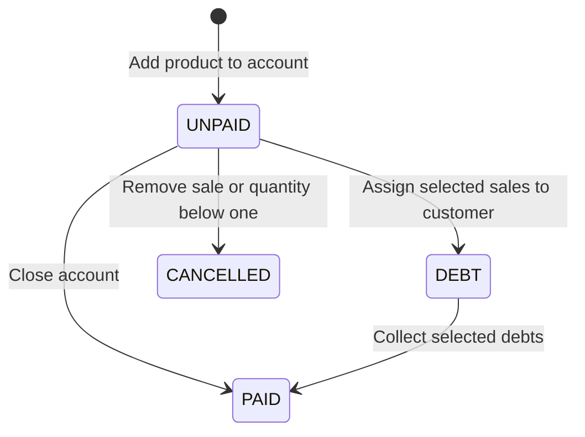

# Business rules

This reference describes the implemented behavior of Comal Core. It separates
server checks from interface controls and records the limits that matter when
changing or operating the system. Function contracts are in
[Action reference](actions.md). Screens are in [Modules](modules.md).

## Terms

| Term | Meaning |
| --- | --- |
| Jornada | Shared cash shift used by multiple users. OPEN or CLOSED |
| Account | Sale records grouped by source_type |
| Sale record | Persisted order entry. A POS product tap normally creates one |
| Guest ticket | Reusable `VL-<n>` identifier for an open guest account |
| Debt / fiado | Sale assigned to a customer for later full collection |
| Cash cut | Expected cash and transfers for a jornada. Only cash has a counted closing amount |
| Pool | Savings deposits minus withdrawals |
| Goal contribution | Progress assigned to a savings goal, independent of pool movements |

## 1. Authentication and authorization

Sources: [authentication](../lib/auth.ts),
[login actions](../lib/actions/auth_action.ts) and
[route permissions](../lib/permissions.ts).

ADMIN logs in with email and password. STAFF uses a username and a PIN containing
four digits. Credentials are compared with bcrypt. Inactive users cannot log in.

JWT sessions last eight hours. They carry the user ID and role.
Roles other than ADMIN normalize to STAFF.

Both roles can open POS, Egresos and Deudores. ADMIN routes require ADMIN.
Actions check permissions independently. Most reads require a session.
Writes to products, supplies and users require ADMIN. Salary payments, jornada
control, savings writes and settings writes also require ADMIN.
Every analytics query and export checks ADMIN.

Customer writes require only a session. The CRM screen is restricted to ADMIN.

Actions identify the employee through the session. This applies to sales,
expenses, savings, jornada control and debt collection.

The JWT callback reloads activity and role from the database on each session
check. Deactivation or a missing user invalidates the session; a database failure
also prevents authorization. A null activity value remains accepted.

## 2. Sales and account lifecycle

Sources: [sales actions](../lib/actions/sales.ts),
[account identifiers](../lib/pos-source.ts),
[desktop POS](../app/(dashboard)/pos/pos-manager.tsx) and
[mobile POS](../app/(dashboard)/pos/MobilePosManager.tsx).

### Creation and inventory

`createSale` requires a session and an OPEN jornada. It validates item IDs and
positive integer quantities, the source/customer fields, payment method and a
status other than CANCELLED. An omitted payment method defaults to CASH.

The server reads prices and recipes, computes `subtotal = price × quantity`,
stores item unit prices/subtotals and subtracts
`quantityUsed × item quantity` from each supply. Sale, stock and related
customer/debt changes share a transaction.

A linked customer's lastConsumption is updated. Customer ID -1 or a falsy ID
means no customer. Creating a DEBT sale with a customer also creates its debtor
row and increases the customer's balance. The normal POS starts with UNPAID
records and settles them later.

Stock availability is not checked before creating a sale or increasing quantity,
so stock can become negative. Shape validation does not establish ownership or
make every business state transition safe.

### Source identifiers

| Source | Account |
| --- | --- |
| `MESA_<n>` | Table |
| `CL- <customerId>` | Customer selected from CRM |
| `VL-<n>` | Open guest ticket |
| `VENTA_LIBRE` | Settled guest history |

The server selects the lowest positive ticket number not used by UNPAID sales
in the active jornada. Selection does not reserve it. Concurrent requests can
choose the same number.

Customer accounts use the customer primary key (`CL- <customerId>`), ensuring
customers with duplicate names maintain independent accounts. source_type is
limited to 30 characters. See [Database](database.md).

### Normal state transitions



`closeAccountAction` pays all matching UNPAID records in the active jornada,
using CASH or TRANSFER. An omitted method defaults to CASH. For a valid guest
ticket, it rewrites the source to VENTA_LIBRE and frees the number.
A request with no matching records can succeed with count 0.

The account view shows UNPAID records. Payment or debt conversion returns the
operator to venta libre. Switching views alone does not settle an account.
The POS loads today's sales using the server's local day. Cancelled sales are
excluded. The view does not recover every open account from earlier days.

`updateSaleQuantity` keeps the stored unit price, adjusts stock by the quantity
difference and recalculates totals. It requires a positive integer quantity. The
POS decrement from one explicitly cancels the whole sale. Cancellation restores
stock using current recipes,
marks the sale CANCELLED and retains its records. Repeated cancellation fails.

Cancellation and quantity actions do not restrict every edit to UNPAID sales
or require an OPEN jornada. Cancelling a sale with an open debt also cancels
that debt. The action reduces the customer balance.

Cancelling after collection leaves the collection record in place.
The cash cut excludes it because the sale is no longer PAID. Cancellation may retain the previous payment method.

Recipe changes can alter the stock restored on cancellation because recipes
are not stored as historical snapshots.

## 3. Payment confirmation

Sources: [desktop dialog](../components/Sales-input-client.tsx),
[mobile POS](../app/(dashboard)/pos/MobilePosManager.tsx),
[debt dialog](../app/(dashboard)/debtors/debt-payment-dialog.tsx) and
[transfer dialog](../components/Transfer-confirmation-dialog.tsx).

| Flow | Cash | Transfer |
| --- | --- | --- |
| Desktop POS | Receipt and explicit confirmation button | Shared transfer confirmation |
| Mobile POS | Required received amount and calculated change | Shared transfer confirmation |
| Deudores, desktop/mobile | Required received amount and calculated change | Shared transfer confirmation |

Cash inputs in mobile POS and Deudores accept nonnegative amounts with up to
two decimal places, using dot or comma and no thousands separators. Values must
fit safe integer cents. Empty, invalid or insufficient amounts block payment.

Change equals received cents minus the sum of each sale total rounded to cents.
Insufficient cash shows the missing amount. Enter in the mobile cash input
blurs it. Only the confirmation button records payment. Received cash and
change are UI state, not stored payment fields.

The transfer dialog loads CLABE, shows the total and asks the operator to
confirm receipt. Confirmation is blocked while loading. A blank CLABE shows
a notice but does not block confirmation once loading finishes.
Cancelling either payment dialog leaves the account unpaid.

Transfers are confirmed manually. There is no bank lookup, automatic
reconciliation or verification token. Settlement actions accept a method and
update status. They do not require proof that the UI confirmation occurred.

## 4. Debts and customer balance

Source: [debts.ts](../lib/actions/debts.ts).

`toDebt` and `payAccount` require a session and an OPEN jornada. Otherwise they
return UNAUTHORIZED or NO_OPEN_JORNADA. They validate the customer ID and selected
sale IDs. Collection also validates the payment method. Malformed input returns
INVALID_INPUT. Amounts come from the database, not the caller.

| Operation | Effect |
| --- | --- |
| `toDebt` | Selects UNPAID sales, upserts one debtor row per sale, assigns the customer, sets DEBT, increases currentBalance and records creation time/jornada |
| `payAccount` | Selects DEBT sales, marks debt/sale PAID, assigns the payment method, lowers currentBalance and records collection time/jornada/employee |

The actions select requested IDs in the eligible status. No eligible records
returns NO_UNPAID_SALES or NO_DEBT_SALES. `toDebt` accepts anonymous sales or
sales assigned to the requested customer; `payAccount` requires the sale and
any existing debtor row to match that customer. A mismatch returns INVALID_INPUT
for the entire eligible batch before writes. If a debtor row is missing,
collection retains its transaction failure behavior.
Collection fully settles the selected sales. Partial payments and a general
payment allocation ledger are not implemented.

| Debt field | Meaning |
| --- | --- |
| status | DEBT while pending, PAID after collection. An open debt becomes CANCELLED with its sale |
| createdAt / createdJornadaId | When and in which jornada the debt was granted |
| paidAt / paidJornadaId | When and in which jornada it was collected |
| collectedBy | Employee receiving the money, taken from the session |

Converting a sale to debt resets its collection fields. Collection preserves
the sale's original creation time and jornada. The cash cut uses paidJornadaId
to attribute the receipt to the current jornada.

The debtor list groups DEBT rows by customer. Its summary counts those amounts,
distinct customers, and PAID debt amounts collected today by paidAt.
The operational list and analytics debt report use different filters.

The queries do not verify that every selected sale belongs to the current
jornada. Candidate and customer checks occur before the write transaction, so
concurrent changes can bypass them. Duplicate/concurrent requests are not a
fully protected idempotent collection protocol and can affect stored balances.

## 5. Jornadas and cash

Sources: [jornada actions](../lib/actions/jornada.ts),
[cash calculation](../lib/jornada-cash.ts) and
[jornada screen](../app/(dashboard)/admin/jornada/jornada-manager.tsx).

Only ADMIN opens or closes jornadas, including a jornada opened by another
ADMIN. Opening and counted closing cash must be finite and nonnegative.
An existing OPEN jornada blocks opening with PENDING_JORNADA.
The application serializes opening requests and checks for an open shift inside
the same transaction. Shifts are closed by an operator.

Closing requires an OPEN jornada and rejects any remaining UNPAID accounts
with OPEN_ACCOUNTS, including source, count and total. Pay, convert to debt or
cancel those accounts first.

Sales creation, account closure, debt creation/collection, expenses, salary
payments and pool movements require an OPEN jornada. Goal contributions do not.

### Cash cut

The cut separates direct sales from debt collections to count each receipt once:

- PAID sales without a debtor row count in their original jornada.
- Collected debts count in paidJornadaId, provided both debt and sale are PAID.
- Only CASH and TRANSFER methods count on their respective sides. A null method
  is excluded.
- Expenses and salaries belong to the jornada open when registered.
- Savings deposits move cash from the drawer to the pool. Withdrawals reduce
  the pool balance only.

```text
expected cash =
    opening amount
  + paid cash sales without a debt record
  + cash debt collections received in this jornada
  - cash expenses
  - cash salary payments
  - savings deposits

closing difference = counted cash - expected cash

expected transfers =
    paid transfer sales without a debt record
  + transfer debt collections received in this jornada
  - transfer expenses
  - transfer salary payments
```

Transfers start from zero for each jornada. There is no counted transfer amount
or transfer difference. Debt created in the jornada and total pending debt are
informational figures. Neither changes expected cash/transfers.

Cash example: 500 opening + 300 sales + 80 collections - 50 expenses - 40
salaries - 100 deposits = 690 expected. Counting 650 gives -40.
A subsequent 20 withdrawal reduces the savings balance by 20 and leaves the
expected cash at 690.
Transfer example: 200 sales + 60 collections - 30 expenses - 100 salaries = 130.

A debt granted in jornada 1 and collected in jornada 2 adds money to jornada 2.
It does not rewrite jornada 1's stored closing amounts. Collections lacking
paidJornadaId cannot be attributed by this calculation.

Closing stores CLOSED, closing user/time, expected cash, expected transfers and
counted cash. The live view and closing action share getJornadaCashSummary.
They use the same formula, but concurrent activity can change data between
screen display and closing.

The active summary returns NO_JORNADA, OWN_OPEN or OTHER_OPEN. Employee totals
group PAID sale records by placing user. They do not count visits. STAFF sees
the banner without editing controls.

Closing checks open accounts, calculates the cash summary, stores closing
amounts and clears guest reservations in one transaction. Sales and cash
movements that affect the cut use the same shift lock. Stored closing amounts
are the historical record.

## 6. Inventory, recipes and menu prices

Sources: [inventory](../lib/actions/inventory.ts),
[products](../lib/actions/products.ts) and [schemas](../lib/actions/schemas.ts).

ADMIN can save or deactivate supplies. Names/units must be nonempty, manually
saved stock must be nonnegative, and unitCost must be positive.
Listings show active supplies alphabetically. Deactivation preserves recipe
references. Deletion validates an integer supply ID.

Desktop and mobile support name and stock filters: stock > 0 is in stock. Stock <= 0 is out of stock. Units are kg, g, Lt and piece. No automatic unit
conversion is implemented. Stock, recipe quantity and cost must use the same unit.

ADMIN product writes require a name between 3 and 40 characters and a positive
price. For a nonempty supplied or preserved recipe, the server requires
price > sum(current supply unitCost × quantityUsed), rounded to two decimal places.

Supplied recipes replace the stored recipe. An empty array removes it.
Omitting recipes preserves them and checks their current base cost. Recipe quantities
must be nonnegative. Product deletion validates an
integer ID and physically deletes. Foreign keys can block it.

Displayed utility is current sale price minus current recipe cost. It is not
historical profit.

## 7. CRM and users

Sources: [customers](../lib/actions/customers.ts), [users](../lib/actions/users.ts)
and [CRM](../app/(dashboard)/admin/crm/crm-manager.tsx).

Customer writes validate optional id, name and phone and store the parsed values.
Names need at least three characters. Blank phone becomes null. New customers
start with balance 0 and a registration date. Balance and alias are not editable
through this action.

Server search checks names and aliases without regard to letter case.
It returns alphabetic results and defaults to 20 rows.
The POS picker waits 300 ms before searching.

CRM can sort by newest registration or Spanish name order from A to Z.
IDs determine the order when dates match.

Staff search matches name/username, defaults to 20 and does not limit results
to active STAFF users. GetAllUsers exposes hasPassword/hasPin flags, not hashes.

ADMIN creates and edits users. Names require between 3 and 50 characters and must
include at least one surname. Role must be ADMIN or STAFF. STAFF accounts require a
four-digit numeric PIN; ADMIN accounts require a password of at least four characters.
Credentials use bcrypt with cost 10.

Account creation generates a unique username from initials, surname syllables,
and random digits. ADMIN accounts require a valid email address.

Editing a user preserves existing credentials when omitted. Supplying a new
credential sets that value and clears the other credential field. Updates can modify
the email. Role transitions preserve login access: transitioning to STAFF generates
a username if none exists, and transitioning to ADMIN requires a valid email address
if none is set. Email and username are unique in the database; NULL values are allowed
for STAFF accounts.

## 8. Expenses and salary payments

Sources: [expenses](../lib/actions/expenses.ts),
[payroll](../lib/actions/payrolls.ts) and
[salary screen](../app/(dashboard)/admin/roster/page.tsx).

Expense registration requires a session and an OPEN jornada.
The amount must be positive. The description must be nonempty.
The caller must provide a Date and choose CASH or TRANSFER.
registered_by comes from the session.

Category is optional in the shared schema. The UI requires a category.
It also trims the description and rejects an empty result.

The UI categories are Insumos, Servicios, Mantenimiento and Otros.
The server accepts other category strings.

Expense history loads 30 rows by default, ordered by date then ID descending.
Its total covers all expenses, not just the loaded page.

Salary registration requires ADMIN and an OPEN jornada. It accepts an integer
user ID, positive amount, nonempty period and explicit payment method. It stores
the active jornada and today's payDate as a calendar date.

The UI offers ADELANTO, BONO and SUELDO. These are labels, not values from a
database enum for salary types. The period field stores `<type>: <reason>`.
The reason must have at most 50 Unicode code points, and the complete period including the prefix must have at most 65 Unicode code points.

A summary shows the payment method before final confirmation.
There is no action to update, delete or reverse a salary payment.
Registration does not create a separate expense row.

History loads 30 rows for the selected user. It sorts by date, then ID, in
descending order. User search waits 300 ms.

## 9. Savings and goals

Source: [savings.ts](../lib/actions/savings.ts).

Pool balance is total DEPOSIT amounts minus WITHDRAW amounts. ADMIN pool writes
require an OPEN jornada and a positive finite amount. Withdrawals exceeding
the queried pool balance fail. Each movement records employee and jornada.
Recent movements default to limit 20, offset 0. The limit argument comes first.

ADMIN creates goals with a nonblank name, positive target and optional deadline
or description. Cancellation sets CANCELLED. Contributions must be positive and
finite. An ACTIVE goal becomes COMPLETED when the total reaches its target.
Displayed progress is capped at 100%. Goal deadlines are displayed in UTC to
preserve their calendar date.

Contributions are independent of pool money: they neither withdraw it nor
require a jornada. The action does not reject a contribution solely because a
goal is already COMPLETED or CANCELLED. Goals/contributions have no delete or
reversal action.

Pool balance validation and movement insertion are separate operations, so
concurrent withdrawals are not protected by a locked balance update.

## 10. Statistics and reports (beta)

Sources: [analytics actions](../lib/actions/analytics.ts) and
[date/report helpers](../lib/analytics.ts).

All queries and exports require ADMIN and valid from/to calendar dates with
from <= to. The default range is 30 days including today. Shortcuts, custom
dates, report type and page are reflected in the URL.

Sales use their current PAID status and creation date, not collection date.
A sale record may represent one product tap, so paidRecords is not ticket count
or visits. There is no metric for average ticket value.

Timestamps are grouped in America/Mexico_City. Columns storing calendar dates retain
their date meaning. Timestamp ranges include the first day and exclude the
midnight after the final day. Comparisons use the preceding period of equal length. A zero previous amount/unit count gives a null percentage.

Statistics include amounts, units, record counts, identified customers, time
distributions, products, methods, sources, expense categories and salaries by
user. Product totals use historical item quantities/subtotals. Labels use
current product/customer names.

A missing sale total falls back to item subtotals with a notice. If neither is
available, its amount is unknown and excluded from money sums with a notice.
Undated expenses/salaries are excluded with a notice. Failures return permission,
filter or query errors, rather than fabricated zero results.

| Report | Included records and date |
| --- | --- |
| sales | Current PAID sales, by creation timestamp |
| products | Item totals for those paid sales |
| expenses | Bills by calendar date |
| salaries | Salary rows by payment calendar date |
| customers | Identified customers linked to paid sales in the period |
| debts | Positive DEBT rows with null paidAt and a linked DEBT sale, by original sale date |

Debt age is calendar days from original sale date to query day, with a minimum
of zero. The debt report shows current pending balances for origins in the
range, not the balance at a historical close. It excludes settled/cancelled
sales. The operational debt list checks debtor status alone.

Reports have pages of 50 rows and clamp an page outside the available range to the final page.
Exports query all matching rows and totals, independent of the visible page. A later export can change when the database changes.

CSV uses a UTF-8 BOM, escaped/quoted fields, CRLF, a total row and decimals without
thousands separators. Text that resembles a formula is prefixed to prevent spreadsheet
execution. Browser printing includes all matching rows. PDF output depends on
the browser.

Forecasts, historical recipe profit, a general collection ledger and exact
historical cash flow reconstruction are not implemented.

## 11. Business and device settings

Sources: [settings](../lib/actions/settings.ts) and
[device settings](../lib/device-settings.ts).

Any session can read CLABE. Only ADMIN saves it. It may be blank or exactly
18 digits after outer whitespace is trimmed. The UI strips characters other than digits. The action
rejects embedded spaces. Validation checks length/digits, not bank ownership or
the CLABE checksum. The shared key is CLABE.

Terminal names stay in each browser's localStorage and are not sent to the
server. Clearing browser data removes the name. Hydration state is temporary.
[Architecture](../ARCHITECTURE.md) describes browser persistence and refresh.
