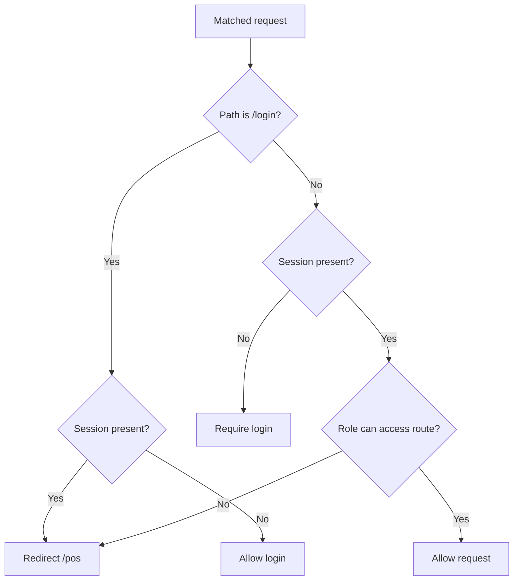

# Request interception (proxy)

[`proxy.ts`](../proxy.ts) wraps Auth.js with the shared
[`app/auth.config.ts`](../app/auth.config.ts). It is the Next.js 16 entry point
for session and route checks.

```ts
export default NextAuth(authConfig).auth;

export const config = {
  matcher: "/((?!api|_next/static|_next/image|icon.svg).*)",
};
```

## Which requests it checks

The matcher excludes paths beginning with `api`, `_next/static`, `_next/image`
or `icon.svg`. Authentication handlers under `/api/auth` remain reachable.
Other matching paths run the authorized callback.

The shared Auth.js config has `providers: []` and uses Prisma to reload the
user's activity and role in the JWT callback. The proxy runs on the Node.js
runtime. The Credentials provider and bcrypt remain in `lib/auth.ts`.

## Authorization flow



| Request | Result |
| --- | --- |
| Guest on `/login` | Allow |
| Authenticated user on `/login` | Redirect to `/pos` |
| Guest on another matched path | Return false. Auth.js uses `/login` as the login page |
| Authenticated user denied by canAccessRoute | Redirect to `/pos` |
| Other authorized request | Allow |

Both roles can open `/pos`, so it is a permitted redirect target.
[Authentication](auth.md) explains how JWT and session callbacks carry role/ID.

## Routes and Server Actions

`ROUTE_PERMISSIONS` checks prefixes of complete path segments and uses the first match.
Unmatched authenticated paths are allowed. Navigation uses these same rules. Action permissions are independent.

The matcher checks paths, not whether a request calls a Server Action.
An action POST may pass through the proxy. Each action still needs its own
session/role check, input validation and business rules.
See [Action reference](actions.md).

When adding a route, check its intended ACL entry and navigation. Existing
`/admin/...` pages inherit the ADMIN rule. Keep credential provider and bcrypt
work in `lib/auth.ts`, and retain `proxy.ts` as the interception entry point.
