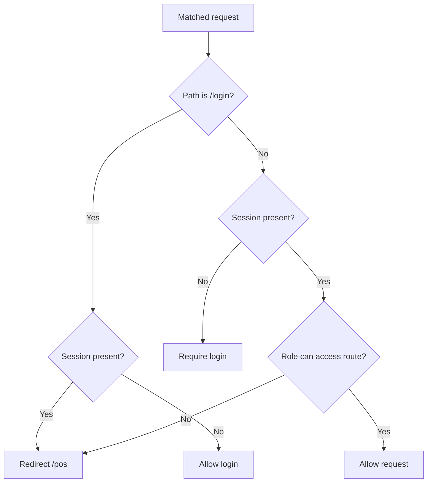

# Request interception (proxy)

[`proxy.ts`](../proxy.ts) wraps Auth.js with the shared
[`app/auth.config.ts`](../app/auth.config.ts). It is the Next.js 16 entry point
for session and route checks.

```ts
export default NextAuth(authConfig).auth;

export const config = {
  matcher: "/((?!api|_next/static|_next/image|icon.svg).*)",
};
```

## Which requests it checks

The matcher excludes paths beginning with `api`, `_next/static`, `_next/image`
or `icon.svg`. Authentication handlers under `/api/auth` remain reachable.
Other matching paths run the authorized callback.

The shared Auth.js config has `providers: []` and uses Prisma to reload the
user's activity, role and credential version in the JWT callback. The proxy runs
on the Node.js runtime. `lib/auth.ts` registers the Credentials provider. Owner
password and six-digit staff PIN verification, terminal cookie checks and
persistent lockout live in the authentication modules. The owner is the sole
`ADMIN`; staff roles are `SUPERVISOR` and `STAFF`. Unknown roles are rejected.

## Authorization flow



| Request | Result |
| --- | --- |
| Guest on `/login` | Allow |
| Authenticated user on `/login` | Redirect to `/pos` |
| Guest on another matched path | Return false. Auth.js uses `/login` as the login page |
| Authenticated user denied by canAccessRoute | Redirect to `/pos` |
| Other authorized request | Allow |

The owner, Supervisor and Service roles can open `/pos`, subject to live
capability checks for specific operations. It is a permitted redirect target.
[Authentication](auth.md) documents setup, terminal linking, sessions and the
role-permission model.

## Routes and Server Actions

`ROUTE_PERMISSIONS` uses the first matching complete path prefix. Unmatched
authenticated paths are allowed. Navigation uses the same rules; actions
authorize their calls independently.

The matcher checks paths, not whether a request calls a Server Action.
An action POST may pass through the proxy. Each action still needs its own
session/role check, input validation and business rules.
See [Action reference](actions.md).

When adding a route, check its intended ACL entry and navigation. Existing
`/admin/...` pages require the capability assigned to each page; owner access
controls require `settings.manage`. Keep authorization in server actions and
queries as well as page guards. Retain `proxy.ts` as the interception entry
point; page visibility does not replace server-side checks.
